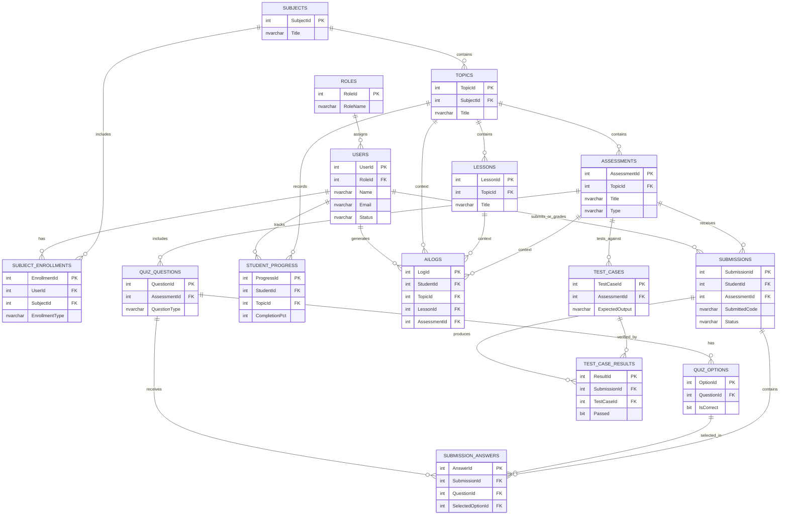

# Synora Database Design (SQL Server)

## Overview
This document outlines the Phase 2 Database Design for the Synora Live Smart Edification platform, targeting Microsoft SQL Server. The design is derived from the core functional workflows specified in the system DFDs, page inventories, and wireframe prototypes.

## 1. DFD Data Store Mapping
This design implements the five abstract data stores identified in the Synora Level 1 Data Flow Diagram (DFD):
- **D1 User Data**: Represented by `Users` and `Roles` tables.
- **D2 Course Content**: Represented by `Subjects`, `SubjectEnrollments`, `Topics`, and `Lessons`.
- **D3 Assessment Data**: Represented by `Assessments`, `QuizQuestions`, `QuizOptions`, and `TestCases`.
- **D4 Submission Data**: Represented by `Submissions`, `SubmissionAnswers`, and `TestCaseResults`.
- **D5 Analytics Data**: Represented by `StudentProgress` and `AILogs`.

## 2. Entity List
- **Roles**: RBAC structure defining system permission levels.
- **Users**: Core entity for Students, Faculty, and Administrators.
- **Subjects**: Top-level learning domains (e.g., C Programming, DBMS).
- **SubjectEnrollments**: Junction table assigning Faculty to teach, and Students to learn specific Subjects.
- **Topics**: Thematic divisions within a Subject.
- **Lessons**: Individual instructional units containing content and resources.
- **Assessments**: Evaluation items, encompassing both Quizzes and Practical Coding Tasks.
- **QuizQuestions**: Individual questions within a quiz.
- **QuizOptions**: Available options/answers for a quiz question.
- **TestCases**: Execution parameters for Practical Coding Tasks.
- **Submissions**: Student responses to assessments, storing practical code or SQL.
- **SubmissionAnswers**: Individual student answers to quiz questions.
- **TestCaseResults**: Detailed outcomes of automated tests run against student code submissions.
- **StudentProgress**: Tracking entity for student completion metrics.
- **AILogs**: Interaction records for the conversational AI companion.

---

## 3. Entity Attributes and Schema Definition

### 3.1 D1: User Data (Core & RBAC)

#### Roles
| Attribute | Data Type | Key/Constraint | Description |
|---|---|---|---|
| RoleId | INT | PK, IDENTITY(1,1) | Unique identifier. |
| RoleName | NVARCHAR(50) | UNIQUE, NOT NULL | 'Student', 'Faculty', 'Admin'. |
| Description | NVARCHAR(255) | NULL | Details about role permissions. |

#### Users
| Attribute | Data Type | Key/Constraint | Description |
|---|---|---|---|
| UserId | INT | PK, IDENTITY(1,1) | Unique identifier for the user. |
| RoleId | INT | FK -> Roles(RoleId) | Links to the RBAC matrix. |
| Name | NVARCHAR(100) | NOT NULL | User's full name. |
| Email | NVARCHAR(255) | UNIQUE, NOT NULL | User's email address (used for login). |
| PasswordHash | NVARCHAR(255) | NOT NULL | Hashed password. |
| Status | NVARCHAR(20) | NOT NULL, DEFAULT 'Active' | 'Active' or 'Suspended'. |
| LastLogin | DATETIME2 | NULL | Timestamp of last authentication. |
| CreatedAt | DATETIME2 | NOT NULL, DEFAULT GETDATE() | Record creation timestamp. |

### 3.2 D2: Course Content

#### Subjects
| Attribute | Data Type | Key/Constraint | Description |
|---|---|---|---|
| SubjectId | INT | PK, IDENTITY(1,1) | Unique identifier for the subject. |
| Title | NVARCHAR(150) | NOT NULL | Subject name (e.g., "C Programming"). |
| Description | NVARCHAR(MAX) | NULL | Subject overview. |
| CreatedAt | DATETIME2 | NOT NULL, DEFAULT GETDATE() | Record creation timestamp. |

#### SubjectEnrollments
| Attribute | Data Type | Key/Constraint | Description |
|---|---|---|---|
| EnrollmentId | INT | PK, IDENTITY(1,1) | Unique identifier. |
| UserId | INT | FK -> Users(UserId) | The user enrolled or assigned. |
| SubjectId | INT | FK -> Subjects(SubjectId) | The target subject. |
| EnrollmentType| NVARCHAR(20) | NOT NULL | 'Student' or 'Faculty'. |
| EnrolledAt | DATETIME2 | NOT NULL, DEFAULT GETDATE() | Enrollment timestamp. |

#### Topics
| Attribute | Data Type | Key/Constraint | Description |
|---|---|---|---|
| TopicId | INT | PK, IDENTITY(1,1) | Unique identifier for the topic. |
| SubjectId | INT | FK -> Subjects(SubjectId) | The parent subject. |
| Title | NVARCHAR(150) | NOT NULL | Topic name (e.g., "Control Flow"). |
| OrderIndex | INT | NOT NULL | Display order within the subject. |
| IsPublished | BIT | NOT NULL, DEFAULT 0 | Publishing status (0 = Draft, 1 = Published). |

#### Lessons
| Attribute | Data Type | Key/Constraint | Description |
|---|---|---|---|
| LessonId | INT | PK, IDENTITY(1,1) | Unique identifier for the lesson. |
| TopicId | INT | FK -> Topics(TopicId) | The parent topic. |
| Title | NVARCHAR(150) | NOT NULL | Lesson name. |
| ContentBody | NVARCHAR(MAX) | NULL | The main instructional content (Markdown/HTML). |
| Objectives | NVARCHAR(MAX) | NULL | JSON string or text detailing learning objectives. |
| OrderIndex | INT | NOT NULL | Display order within the topic. |

### 3.3 D3: Assessment Data

#### Assessments
| Attribute | Data Type | Key/Constraint | Description |
|---|---|---|---|
| AssessmentId | INT | PK, IDENTITY(1,1) | Unique identifier for the assessment. |
| TopicId | INT | FK -> Topics(TopicId) | The parent topic. |
| Title | NVARCHAR(150) | NOT NULL | Assessment title. |
| Type | NVARCHAR(20) | NOT NULL | 'Quiz' or 'Practical'. |
| Instructions | NVARCHAR(MAX) | NULL | Prompt and problem statement. |
| TargetLanguage | NVARCHAR(20) | NULL | 'C', 'C++', or 'SQL' (Applicable to Practical). |
| StarterCode | NVARCHAR(MAX) | NULL | Initial code template provided to the student. |
| MaxScore | DECIMAL(5,2) | NOT NULL, DEFAULT 10.0 | Maximum possible points. |
| TimeLimitMs | INT | NULL | Execution time limit in milliseconds. |
| MemoryLimitMb | INT | NULL | Execution memory limit in MB. |

#### QuizQuestions
| Attribute | Data Type | Key/Constraint | Description |
|---|---|---|---|
| QuestionId | INT | PK, IDENTITY(1,1) | Unique identifier for the question. |
| AssessmentId | INT | FK -> Assessments(AssessmentId) | The parent assessment (Quiz). |
| QuestionText | NVARCHAR(MAX) | NOT NULL | The question prompt. |
| QuestionType | NVARCHAR(20) | NOT NULL | 'MCQ', 'TrueFalse', 'MultipleAnswer'. |
| Explanation | NVARCHAR(MAX) | NULL | Feedback shown after submission. |

#### QuizOptions
| Attribute | Data Type | Key/Constraint | Description |
|---|---|---|---|
| OptionId | INT | PK, IDENTITY(1,1) | Unique identifier for the option. |
| QuestionId | INT | FK -> QuizQuestions(QuestionId) | The parent question. |
| OptionText | NVARCHAR(MAX) | NOT NULL | The text of the choice. |
| IsCorrect | BIT | NOT NULL | 1 if this is a correct answer, 0 otherwise. |

#### TestCases
| Attribute | Data Type | Key/Constraint | Description |
|---|---|---|---|
| TestCaseId | INT | PK, IDENTITY(1,1) | Unique identifier for the test case. |
| AssessmentId | INT | FK -> Assessments(AssessmentId) | The parent assessment (Practical). |
| InputData | NVARCHAR(MAX) | NULL | STDIN provided to the code execution. |
| ExpectedOutput| NVARCHAR(MAX) | NOT NULL | STDOUT expected for a successful test. |
| IsHidden | BIT | NOT NULL, DEFAULT 0 | 1 if hidden from students prior to submission. |

### 3.4 D4: Submission Data

#### Submissions
| Attribute | Data Type | Key/Constraint | Description |
|---|---|---|---|
| SubmissionId | INT | PK, IDENTITY(1,1) | Unique identifier for the submission. |
| StudentId | INT | FK -> Users(UserId) | The student who submitted. |
| AssessmentId | INT | FK -> Assessments(AssessmentId) | The assessment being answered. |
| SubmittedCode | NVARCHAR(MAX) | NULL | The student's code or SQL query (For Practical tasks). |
| Status | NVARCHAR(20) | NOT NULL | 'Pending', 'Graded', 'Needs Review'. |
| AutoGradeScore| DECIMAL(5,2) | NULL | Score calculated by the automated system. |
| FinalScore | DECIMAL(5,2) | NULL | Final grade assigned (includes manual review). |
| Feedback | NVARCHAR(MAX) | NULL | Manual faculty feedback. |
| GradedBy | INT | FK -> Users(UserId) | Faculty member who reviewed the submission (Nullable). |
| SubmittedAt | DATETIME2 | NOT NULL, DEFAULT GETDATE() | Timestamp of submission. |

#### SubmissionAnswers
| Attribute | Data Type | Key/Constraint | Description |
|---|---|---|---|
| AnswerId | INT | PK, IDENTITY(1,1) | Unique identifier. |
| SubmissionId | INT | FK -> Submissions(SubmissionId) | The parent submission record. |
| QuestionId | INT | FK -> QuizQuestions(QuestionId) | The quiz question being answered. |
| SelectedOptionId| INT | FK -> QuizOptions(OptionId) | The option chosen (Nullable for text answers). |
| TextResponse | NVARCHAR(MAX) | NULL | Fallback for open-ended questions (if needed later). |

#### TestCaseResults
| Attribute | Data Type | Key/Constraint | Description |
|---|---|---|---|
| ResultId | INT | PK, IDENTITY(1,1) | Unique identifier for the test case result. |
| SubmissionId | INT | FK -> Submissions(SubmissionId) | The parent submission. |
| TestCaseId | INT | FK -> TestCases(TestCaseId) | The test case evaluated. |
| Passed | BIT | NOT NULL | 1 if actual output matched expected, 0 otherwise. |
| ActualOutput | NVARCHAR(MAX) | NULL | The execution STDOUT captured. |
| ExecutionTimeMs| INT | NULL | Time taken to execute the test. |

### 3.5 D5: Analytics Data

#### StudentProgress
| Attribute | Data Type | Key/Constraint | Description |
|---|---|---|---|
| ProgressId | INT | PK, IDENTITY(1,1) | Unique identifier. |
| StudentId | INT | FK -> Users(UserId) | The student. |
| TopicId | INT | FK -> Topics(TopicId) | The topic being tracked. |
| CompletionPct | INT | NOT NULL, DEFAULT 0 | Percentage of topic completed (0-100). |
| LastAccessedAt| DATETIME2 | NULL | Timestamp of last access. |

#### AILogs
| Attribute | Data Type | Key/Constraint | Description |
|---|---|---|---|
| LogId | INT | PK, IDENTITY(1,1) | Unique identifier. |
| StudentId | INT | FK -> Users(UserId) | The student interacting with the AI. |
| TopicId | INT | FK -> Topics(TopicId) | (Optional) Context topic. |
| LessonId | INT | FK -> Lessons(LessonId) | (Optional) Context lesson. |
| AssessmentId | INT | FK -> Assessments(AssessmentId) | (Optional) Context assessment. |
| Query | NVARCHAR(MAX) | NOT NULL | Student's input to the AI. |
| Response | NVARCHAR(MAX) | NOT NULL | AI's response. |
| Timestamp | DATETIME2 | NOT NULL, DEFAULT GETDATE() | Time of interaction. |

---

## 4. Relationships and Cardinality

- **Roles** to **Users**: 1:M
- **Users** to **SubjectEnrollments**: 1:M (Users can be enrolled/assigned to many subjects).
- **Subjects** to **SubjectEnrollments**: 1:M (Subjects have many enrolled users).
- **Subjects** to **Topics**: 1:M
- **Topics** to **Lessons**: 1:M
- **Topics** to **Assessments**: 1:M
- **Assessments** to **TestCases**: 1:M
- **Assessments** to **QuizQuestions**: 1:M
- **QuizQuestions** to **QuizOptions**: 1:M
- **Users (Student)** to **Submissions**: 1:M
- **Assessments** to **Submissions**: 1:M
- **Submissions** to **SubmissionAnswers**: 1:M (One quiz submission has answers for multiple questions).
- **Submissions** to **TestCaseResults**: 1:M (One practical submission has results for multiple test cases).
- **Users (Faculty)** to **Submissions**: 1:M (GradedBy relationship).
- **Users (Student)** to **StudentProgress**: 1:M
- **Topics** to **StudentProgress**: 1:M
- **Users (Student)** to **AILogs**: 1:M

---

## 5. Entity-Relationship (ER) Diagram

